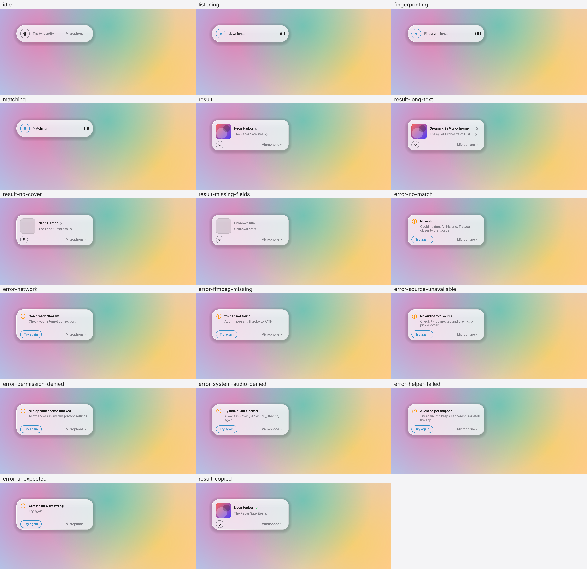
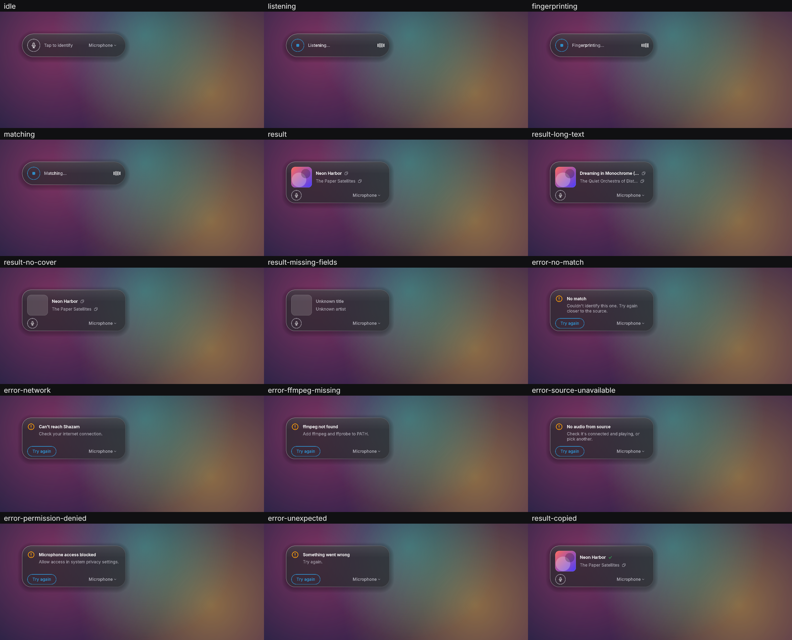

<p align="center">
  <picture>
    <source media="(prefers-color-scheme: dark)" srcset="assets/banner-dark.svg">
    
  </picture>
</p>

<h1 align="center">Shazam Desktop</h1>

<p align="center">
  Compact desktop music recognizer for Windows 11 and macOS.<br>
  Press a global hotkey (or click the button), the app listens for a few seconds and shows the
  title and artist.
</p>

<p align="center">
  <a href="https://github.com/Kavun-Sama/shazam-desktop/releases/latest"></a>
  <a href="https://github.com/Kavun-Sama/shazam-desktop/actions/workflows/build.yml"></a>
  <a href="LICENSE"></a>
  
</p>

<p align="center">Python 3.11+, PySide6, <a href="https://pypi.org/project/ShazamAPI/">ShazamAPI</a>.</p>




## Download and run

Prebuilt binaries are attached to every [release](https://github.com/Kavun-Sama/shazam-desktop/releases):

| File | Platform |
| --- | --- |
| `shazam-desktop-<version>-windows-x64.exe` | Windows x64, single file, no console |
| `shazam-desktop-<version>-macos-arm64.dmg` | macOS on Apple silicon |
| `shazam-desktop-<version>-macos-x86_64.dmg` | macOS on Intel |
| `SHA256SUMS` | checksums of the files above |

They are self-contained: Python, Qt and LGPL builds of `ffmpeg` and `ffprobe` are inside
(see [THIRD_PARTY_NOTICES.md](THIRD_PARTY_NOTICES.md)), so nothing else has to be installed.

Verify a download against `SHA256SUMS`:

```sh
shasum -a 256 -c SHA256SUMS --ignore-missing     # macOS / Linux
Get-FileHash .\shazam-desktop-*-windows-x64.exe  # Windows PowerShell, compare by eye
```

The binaries are **not code-signed or notarized** unless a release says otherwise, so both
systems warn on first launch.

**Windows (SmartScreen).** "Windows protected your PC": click **More info**, then **Run anyway**.
The single-file build unpacks itself to a temporary folder on each start, which takes a moment, and
unsigned PyInstaller executables are sometimes flagged by antivirus software. Building from source
(below) avoids both.

**macOS (Gatekeeper).** The app is ad-hoc signed, not notarized. Open the `.dmg`, drag
**Shazam Desktop** to Applications and start it once. When macOS refuses:

- macOS 15 and newer: **System Settings → Privacy & Security**, scroll down to the message about
  "Shazam Desktop" and press **Open Anyway**.
- Older macOS: Control-click the app, choose **Open**, then **Open** again.
- Or remove the quarantine flag in a terminal:
  `xattr -dr com.apple.quarantine "/Applications/Shazam Desktop.app"`.

Then allow the microphone when asked and press "Try again". The global hotkey also needs
Input Monitoring (see Permissions).

## Install from source

ffmpeg and ffprobe must be on `PATH` (ShazamAPI decodes audio through pydub).

```sh
# Windows
winget install Gyan.FFmpeg
# macOS
brew install ffmpeg
```

```sh
python -m venv .venv
.venv\Scripts\activate          # macOS: source .venv/bin/activate
pip install -e .                # add ".[dev]" for ruff, mypy and pytest
```

## Run

```sh
python -m shazam_desktop
```

- **Ctrl+Shift+1** (macOS: **Cmd+Shift+1**) starts or cancels a run from anywhere, even when
  another window has focus.
- **Esc** cancels a run; when idle it hides the window. The tray / menu-bar icon shows it again.
- Click the result title or artist (or its copy icon) to copy it.
- The chevron next to the source name opens the source menu: Microphone, each input device,
  System Audio. The choice is saved.

Config (`config.json` in the platform config directory, created on first source change):

```json
{"source": "mic:default", "hotkey": "ctrl+shift+1"}
```

Hotkey syntax: modifiers `ctrl`, `shift`, `alt`, `cmd` plus one key, joined with `+`. The file
stores the hotkey on the first source change, so edit it there to override the default.

## Permissions

- **Microphone.** Windows: Settings → Privacy & security → Microphone, allow desktop apps.
  macOS: allow the terminal / Python in System Settings → Privacy & Security → Microphone. The
  first run only triggers the prompt; press "Try again" after granting.
- **macOS global hotkey.** `pynput` needs Input Monitoring for the terminal / Python. Windows
  needs no permission.

## System audio

- **Windows.** WASAPI loopback through PyAudioWPatch, no setup. It mirrors the default output
  device.
- **macOS.** There is no native capture API reachable from Python. Install
  [BlackHole](https://existential.audio/blackhole/), create a Multi-Output Device (your speakers +
  BlackHole) in Audio MIDI Setup and make it the system output. BlackHole then appears as
  System Audio. Without it the entry is disabled with a hint.

## Development

```sh
ruff check . && ruff format --check .
mypy
pytest
python scripts/capture_screenshots.py screenshots   # offscreen renders of every state
pip install -e ".[icons]" && python scripts/build_icons.py   # app icon (.ico, .icns) and README banners
```

Layout: `audio/` capture and sources, `recognition/` pipeline and the `Recognizer` interface (one
ShazamAPI implementation), `settings/`, `ui/`, `controller.py` (Qt-facing facade over the state
machine in `state.py`).

## Build the binaries

CI (`.github/workflows/build.yml`) runs ruff, mypy and pytest, builds the three binaries, runs
`--self-check` on each (Qt and ShazamAPI imports, bundled ffmpeg/ffprobe, offscreen Qt start)
and, for a `v*` tag, publishes a release with `SHA256SUMS`. Code signing and notarization are
optional and switch on when these repository secrets exist:

- macOS: `MACOS_CERTIFICATE` (base64 `.p12`), `MACOS_CERTIFICATE_PWD`, `MACOS_SIGN_IDENTITY`;
  notarization additionally needs `APPLE_ID`, `APPLE_TEAM_ID`, `APPLE_APP_PASSWORD`.
- Windows: `WINDOWS_CERTIFICATE` (base64 `.pfx`), `WINDOWS_CERTIFICATE_PWD`.

Locally (on the platform you build for):

```sh
bash packaging/build_ffmpeg.sh build/ffmpeg          # Windows: from an MSYS2 MINGW64 shell
pip install -e ".[build]"
FFMPEG_DIR=build/ffmpeg pyinstaller --noconfirm packaging/shazam-desktop.spec
dist/shazam-desktop --self-check                     # macOS: dist/"Shazam Desktop.app"/Contents/MacOS/...
```

`--self-check` exits with 0 when everything is in place; `--report FILE` also writes the report
to a file (a windowed Windows build has no console).

## Known limits

- ShazamAPI is an unofficial, reverse-engineered client and can break without notice. It
  hardcodes the `ru/RU` locale.
- The library has no HTTP timeout. The pipeline enforces a 20 s deadline itself; a hung request
  thread is a daemon and lingers until the socket gives up.
- Windows: the hotkey is registered with `RegisterHotKey`, so the foreground app does not
  receive it, and it fails (tray notification) if another app already owns the combination.
  macOS: `pynput` hook, the key is not swallowed.
- Esc cancels only while the window has focus; a repeated hotkey press cancels from anywhere.
- Native backdrop blur: DWM Acrylic needs Windows 11 build 22621+, macOS uses
  `NSVisualEffectView`. Elsewhere, and with Reduce Transparency, a translucent or opaque fill is
  used.
- With native blur on Windows the shadow is drawn by DWM on a best-effort basis.
- The macOS input device list is not refreshed while the app runs; restart after plugging in a
  device.
- Linux is not a goal: the code imports there, but there is no loopback source and no native blur.

## Decisions

- The window is always on top.
- Esc cancels an active run; when idle it hides the window. Ctrl+Q quits (escape hatch without a tray).
- Recognition tries growing windows (5 s, then 10 s) and stops at the first match; the state
  machine has a Matching → Listening retry edge for this.
- "Matching…" is shown when the HTTP request is actually sent (hook on `sendRecognizeRequest`),
  not on a timer.
- Digital silence (2 s of zeros) maps to "Microphone access blocked" on a microphone and to
  "No audio from source" on system audio. A 3 s stall of frames maps to the latter.
- A deadline hit during recognition is reported as a network error.
- The source is stored as `mic:<name>`; a vanished device falls back to the default microphone.
- Loopback-like devices (BlackHole, Soundflower, Loopback, monitors) are excluded from the
  microphone list.
- Windows hotkey: `RegisterHotKey` on a private message-loop thread. It matches by virtual-key
  code, so it works under any keyboard layout and while another window is focused. `pynput`
  matched by layout character (Cyrillic `ы` instead of `s`) and was dropped there.
- Default hotkey is Ctrl+Shift+1 (Cmd+Shift+1 on macOS): a digit key has the same virtual-key
  code in every layout.
- Cancel and the timeout live in the pipeline, not in the library.
- Unspecified UI details: one 13 px system font, hierarchy by weight and colour; pill 72 px →
  card 128 px; width 320 px.
- No config file is written until the source is changed.

## License

MIT, see [LICENSE](LICENSE). Components bundled into the binaries keep their own licenses:
see [THIRD_PARTY_NOTICES.md](THIRD_PARTY_NOTICES.md).
